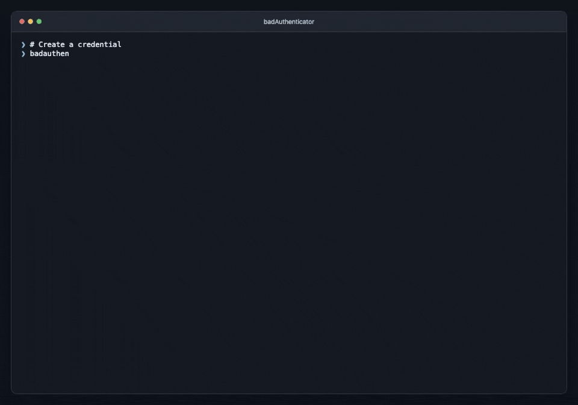

# badAuthenticator

badAuthenticator creates WebAuthn credentials and signs assertions for testing
relying parties. Send options as JSON through the CLI or HTTP API. Use profiles
and output overrides to change the responses the relying party receives.

It can also import credential private keys recovered from data dumps or devices
during red-team engagements. Imports use
[credential JSON](docs/keystore.md#import-export-and-updates) containing the PEM
key and metadata.

It stores credential metadata in SQLite and unencrypted private keys in PEM files.



## Install

Install with Go 1.26.11 or newer:

```sh
go install github.com/tantosec/badAuthenticator/cmd/badauthenticator@latest
```

Or build from a clone:

```sh
git clone https://github.com/tantosec/badAuthenticator.git
cd badAuthenticator
go build -o badauthenticator ./cmd/badauthenticator
./badauthenticator --help
```

To build the container image:

```sh
docker build -t badauthenticator .
docker run --rm badauthenticator --help
```

## CLI

`attest` creates and stores a credential. `assert` signs with a matching stored
credential. Both read options JSON from stdin and write response JSON to stdout:

```sh
./badauthenticator --keystore-dir ./badauthenticator-keystore attest < attestation_options.json
./badauthenticator --keystore-dir ./badauthenticator-keystore assert < assertion_options.json
```

Use `--format decoded` to decode the response fields, or `--human-readable` to
write decoded details to stderr while keeping the response JSON on stdout.

Supported algorithms: ES256, ES384, RS256, PS256, PS384, PS512 and EdDSA.
Attestation uses the first supported algorithm in the RP's `pubKeyCredParams`.
`--alg` selects one explicitly.

### Profiles and overrides

Profiles set defaults for client data, AAGUID, transports and attestation format:

| Profile | Defaults |
|---|---|
| `web` | `crossOrigin: false`, all-zero AAGUID, `internal` transport |
| `android` | Android field order, `com.google.android.gms` package, Google Password Manager AAGUID, no `crossOrigin` |
| `windows-hello-software` | Web client data, Windows Hello Software AAGUID, `internal` transport, packed self-attestation |
| `raw` | No client data or authenticator data assembly |

Credentials store their registration profile for later assertions. Custom
profiles go in `profiles.json` inside the selected keystore. Use `--profiles-file` or
`BAD_AUTHENTICATOR_PROFILES` to select another file.

Both commands also accept an envelope with `options`, `profile`, `clientData`
and `authenticatorData` fields. CLI flags take precedence over envelope values,
which take precedence over profile defaults. Raw byte overrides replace the
corresponding output entirely.

A packed profile may set `attestationType` to `full` to emit a synthetic certificate
chain rooted in an untrusted self-signed CA. The default is `self`.
`--attestation-type` overrides a packed profile on the CLI; see the
[WebAuthn reference](docs/webauthn.md).

`--strict` checks response structure and ceremony fields before returning output.
It does not check every WebAuthn requirement. Credential creation and counter
updates happen before validation, even if validation fails.

See the [CLI reference](docs/cmd.md) for flags and the
[WebAuthn reference](docs/webauthn.md) for profile, override and validation rules.

## HTTP API

```sh
env BAD_AUTHENTICATOR_BEARER_TOKENS="replace-with-at-least-24-characters" \
  ./badauthenticator --keystore-dir ./badauthenticator-keystore serve --port 1337
```

The server binds to `127.0.0.1` by default. API requests require an
`Authorization: Bearer <token>` header. Tokens must be at least 24 characters.
Separate multiple tokens with commas. If the environment variable is unset, the
server generates a token and prints it in the startup logs.

| Endpoint | Methods | Purpose |
|---|---|---|
| `/api/v1/attest` | POST (GET opt-in) | Create and store a credential |
| `/api/v1/assert` | POST | Create an assertion |
| `/api/v1/listCredentials?rpid=example.com` | GET | List credentials for an RP ID |
| `/` | GET | Serve static files without authentication when `--public-dir` is set |

POST requests wrap the WebAuthn options in an `options` field:

```json
{
  "options": {
    "rp": {"id": "example.com", "name": "Example"},
    "user": {"id": "dXNlcg", "name": "user", "displayName": "User"},
    "challenge": "Y2hhbGxlbmdl",
    "pubKeyCredParams": [{"type": "public-key", "alg": -7}]
  }
}
```

Static file serving is disabled by default. Use `--public-dir <PATH>` to serve
an existing directory without authentication.

POST bodies are limited to 10 MiB; larger requests receive HTTP 413.

`--allow-get-attestation` enables `GET /api/v1/attest?options=...` with
URL-encoded JSON or unpadded base64url JSON: bare options or the same envelope.
GET requests with the same `(rp.id, user.id, challenge)` return the first
successful response, even after a restart or changes to other options. All
three fields are required.

POST requests always create a new credential, including duplicates.

`--allow-unauthenticated-attestation` removes bearer authentication from the
attestation route only. This mode lets anyone who can reach that route create
credentials.

See the [HTTP API reference](docs/http.md) for request handling and errors.

## Keystore

Pass `--keystore-dir <PATH>` on each command; it is created if needed. For a
local store, use `./badauthenticator-keystore`. Existing `./keystore` data remains
available by passing that path. The directory contains
`metadata.db`, `keys/<credential-id>.key.pem` (PKCS#8), and optional `profiles.json`.

```sh
./badauthenticator --keystore-dir ./badauthenticator-keystore keystore list
./badauthenticator --keystore-dir ./badauthenticator-keystore keystore export --id '<credential-id>'
./badauthenticator --keystore-dir ./badauthenticator-keystore keystore import --from-file credential.json
./badauthenticator --keystore-dir ./badauthenticator-keystore keystore update '<credential-id>' SignCount 0
./badauthenticator --keystore-dir ./badauthenticator-keystore keystore clear
```

`clear` deletes the entire keystore directory, including any `profiles.json`
stored there. See [Keystore](docs/keystore.md) for the data format and import
behaviour.

## Deployment

For remote access, keep badAuthenticator bound to localhost and put a TLS
reverse proxy in front of it. A Caddy configuration:

```caddyfile
research.example.com {
    reverse_proxy 127.0.0.1:1337
}
```

The container runs as a non-root user. Store its keystore under
`/data/badauthenticator-keystore`. Add `--public-dir /public` to serve the
bundled static files. It must listen on `0.0.0.0` inside the container for a
published port to work:

```sh
docker run --rm \
  -p 127.0.0.1:1337:8080 \
  -v "$(pwd)/badauthenticator_data:/data" \
  -e BAD_AUTHENTICATOR_BEARER_TOKENS="replace-with-a-long-random-token" \
  badauthenticator \
  --keystore-dir /data/badauthenticator-keystore serve --bind-address 0.0.0.0 --port 8080
```

The data volume must be writable by the container user.

## Development

```sh
go test ./...
go vet ./...
```

- [CLI reference](docs/cmd.md)
- [HTTP API](docs/http.md)
- [Keystore](docs/keystore.md)
- [WebAuthn](docs/webauthn.md)
- [Cryptographic providers](docs/authcrypto.md)

## Licence

[MIT](LICENSE). Dependency licences are listed in
[THIRD-PARTY-NOTICES.md](THIRD-PARTY-NOTICES.md).
